# Scalping v2: end-to-end readiness, latency and profitability audit

Date: 2026-10-31 (Europe/Moscow)  
Repository: `traders-ml`  
Audited runtime revision: `4ee98c01563c6c13aded04606c46da467e573fdc`  
Mode: PAPER; LIVE disabled; real exchange order calls: 0  
Accounting session: `TRADERS_PAPER_SESSION_02`; starting capital: 1000 USDT

## Executive verdict

**Overall status: `PAPER_READY_STRATEGY_NOT_PROFITABLE`.** The system is technically capable of receiving candles, running the strategy and producing PAPER plans, but it is not ready for LIVE trading and does not meet the economic acceptance criteria.

The principal current latency bottleneck is upstream of execution: market-data availability plus serial processing of the 20-symbol universe. During the current observation window, a full cycle finished at p50 64.4 s and p95 98.8 s after the 5m candle boundary. The first fresh natural plan after the session repair was produced for TRXUSDT 74.8 s after the boundary. The causal entry deadline is boundary +60 s, so the system correctly rejected it as `ENTRY_FILL_WINDOW_MISSED`; no command, fill or position was created.

Changing capital from 100 to 1000 USDT does not improve signal quality, win rate, profit factor or expectancy. It increases position quantity and absolute profit/loss approximately tenfold when the order is not limited by cash or exchange minima.

The requested profitability target is not proven: historical compatible PAPER evidence has win rate 24.35%, profit factor 0.306 and negative expectancy. The WLDUSDT replay produced no eligible validation trades and therefore cannot justify parameter promotion.

## Evidence status legend

- `RUNTIME_PROVEN`: measured from the running PAPER system and production database.
- `TEST_PROVEN`: verified by deterministic tests.
- `STATIC_PROVEN`: verified from the deployed code/configuration.
- `HISTORICAL_ONLY`: measured from earlier compatible PAPER records.
- `UNPROVEN`: insufficient observation or sample size.

## End-to-end chain

```mermaid
flowchart LR
  A[Binance closed candles] --> B[market-data sync]
  B --> C[5m boundary and freshness]
  C --> D[20-symbol orchestrator]
  D --> E[analysis and setup]
  E --> F[risk and PAPER plan]
  F --> G[selector]
  G --> H[execution command]
  H --> I[simulated fill]
  I --> J[open position]
  J --> K[exit evaluation]
  K --> L[exit fill and PnL]
```

## Current latency ledger

Observation: last 60 minutes on 2026-10-31; 240 runs, 12 complete cycles, 20 symbols per cycle.

| Stage | p50 | p95 | max | Status | Interpretation |
|---|---:|---:|---:|---|---|
| 5m boundary -> symbol start | 58.95 s | 115.43 s | 115.43 s | `RUNTIME_PROVEN` | Data arrival/scheduling and serial queue dominate. |
| 5m boundary -> symbol finish | 61.17 s | 117.58 s | 119.54 s | `RUNTIME_PROVEN` | Often beyond the 60 s causal entry deadline. |
| Strategy run duration | 2.254 s | 3.939 s | 10.821 s | `RUNTIME_PROVEN` | Computation is material but not the main delay. |
| First symbol start per cycle | 58.75 s | 71.81 s | — | `RUNTIME_PROVEN` | Even the earliest work starts close to/after the deadline. |
| Last symbol start per cycle | 59.13 s | 94.95 s | — | `RUNTIME_PROVEN` | Serial universe processing makes late symbols worse. |
| Full 20-symbol cycle finish | 64.45 s | 98.79 s | 119.54 s | `RUNTIME_PROVEN` | Current cycle does not meet the <60 s entry constraint. |
| Readiness check, warm | 178.8 ms | 669.4 ms | 947 ms | `HISTORICAL_ONLY` | Not the dominant bottleneck. |
| Selector computation | — | 0.130 ms | — | `HISTORICAL_ONLY` | Negligible. |
| Boundary -> command | 30.8 s | 40.5 s | — | `HISTORICAL_ONLY` | Earlier successful lifecycle evidence. |
| Command -> OPEN fill | 29.2 s | 36.6 s | — | `HISTORICAL_ONLY` | Mostly configured next-candle simulation, not CPU delay. |
| Exit decision -> exit fill | 60 s | 60 s | — | `HISTORICAL_ONLY` | Intentional one-candle PAPER fill policy. |
| 1m close -> persistence | 14–17 s | — | — | `HISTORICAL_ONLY` | Additional market-data/persistence lag. |

The historical 29–60 s command/fill and exit/fill intervals are primarily simulation-policy latency. The present failure happens earlier: a valid plan cannot be produced before the causal +60 s entry deadline.

## Natural TRXUSDT trace

| Event | UTC timestamp | Boundary delta |
|---|---|---:|
| 5m candle boundary | 18:35:00.000 | 0.000 s |
| strategy started | 18:36:04.019 | 64.019 s |
| plan created | 18:36:14.764 | 74.764 s |
| run finished | 18:36:14.841 | 74.841 s |
| operator first observed plan | 18:36:23.658 | 83.658 s |
| terminal decision | 18:36:23.728 | 83.728 s |

Result: selector state `SELECTED`; lifecycle `EXECUTION_FAILED`; reason `ENTRY_FILL_WINDOW_MISSED`. The selector terminalized in about 70 ms after observing the plan. There were zero execution commands and zero positions in `TRADERS_PAPER_SESSION_02`. This proves that the current delay is before selector/command creation.

## Current session funnel

Since the 1000 USDT baseline was initialized:

| Result | Count |
|---|---:|
| `NO_PLAN` | 369 |
| `REJECT` | 30 |
| `PAPER_PLAN_READY` | 1 |
| Commands | 0 |
| Positions | 0 |

Current-session open-to-close latency and current-session PnL are `UNPROVEN`, because no new position has opened. A 24–48 hour passive sample remains required before an operational acceptance decision.

## Capital comparison: 100 vs 1000 USDT

Using the same observed WLDUSDT geometry (entry 0.538, stop 0.53890625, risk 5 bps):

| Capital | Risk budget | Normalized quantity | Notional |
|---:|---:|---:|---:|
| 100 USDT | 0.05 USDT | 55.1 | 29.6438 USDT |
| 1000 USDT | 0.50 USDT | 551.7 | 296.8146 USDT |

Both cases exceed the 5 USDT exchange minimum and neither is cash-capped. Therefore the larger capital changes sizing, not the decision predicates. With negative expectancy it scales expected losses as well as possible gains.

## Profitability evidence

Compatible historical PAPER sample: 193 closed positions, 47 winners, win rate 24.35%, net PnL -17.1058 USDT, profit factor 0.3059, expectancy -0.08863 USDT/trade. This fails all requested gates: win rate >50%, PF >1.2 and positive expectancy.

BNBUSDT is the only positive per-symbol historical slice (8 trades, 62.5% win rate, PF 1.937, net +0.813 USDT), but eight trades are far below an acceptable sample and cannot establish a universal strategy.

### WLDUSDT replay

Artifact: `artifacts/scalping_v2_parameter_sweep/scalping_readiness_wld_20261031_v2`.

- 742 source rows over 29.83 days; 85 full-replay-eligible rows.
- Five calibration trades: net -1.4833, PF 0.4255, expectancy -0.29666.
- Validation: 148 observations; 131 `REJECT_GEOMETRY`, 17 `REJECT_EV`, zero entries and zero exits.
- Replay integrity passed, but sample sufficiency failed. No candidate/finalist may be promoted.

## Session-boundary defect repaired

The operator previously reconciled 282 old missing outcomes into the new accounting session. Revision `4ee98c0` now filters reconciliation by the active baseline timestamp and explicitly assigns the active session. Migration/schema marker `0040_plan_outcome_session_boundary` reclassified the contaminated, unlinked records to `TRADERS_PAPER_SESSION_01`.

Validation: 37 focused tests passed; zero old outcomes remain in SESSION_02; zero commands/positions were affected. Operator and read-only API are healthy, LIVE remains false, and continuous PAPER generation is armed.

## Root-cause ranking

1. **Late market-data/freshness availability after the 5m boundary — `RUNTIME_PROVEN`.** Earliest cycle work has p50 58.75 s.
2. **Serial 20-symbol processing — `RUNTIME_PROVEN`.** Last-symbol start reaches p95 94.95 s.
3. **Per-symbol strategy computation — `RUNTIME_PROVEN`.** p95 3.94 s and max 10.82 s amplify serial delay.
4. **Operator selector — disproven as main bottleneck.** The TRX terminal decision took about 70 ms after observation.
5. **Capital size — disproven as a win-rate cause.** It changes quantity only under current constraints.

## Required implementation sequence

No profitability parameters should be loosened while execution causality is failing. The next safe sequence is:

1. Instrument market-data exchange-close -> DB-persist -> freshness-ready timestamps per timeframe.
2. Make the 20-symbol decision cycle concurrent or partitioned with a bounded worker pool while preserving idempotency and per-symbol ordering.
3. Set acceptance gates: first symbol starts <15 s p95, all symbols finish <45 s p95, plan -> selector <1 s p95, selector -> command <1 s p95.
4. Repeat 24–48 h passive PAPER observation; require at least 20 natural plans and report missed-window rate.
5. Only after latency gates pass, run walk-forward tuning with fees/slippage and minimum sample requirements (at least 100 validation trades overall and 30 per promoted family/symbol slice).
6. Promote nothing unless holdout WR >50%, PF >1.2, positive expectancy and acceptable drawdown all hold together. Do not optimize win rate alone.

## Safety and readiness decision

- PAPER operation: **allowed for observation**.
- Strategy parameter promotion: **blocked by insufficient/negative evidence**.
- LIVE trading: **not allowed**.
- 1000 USDT baseline: active and technically valid; it does not repair edge.
- Current-session position lifecycle: `UNPROVEN` until a natural position opens and closes.
- Final acceptance requires the 24–48 h observation gate and statistically sufficient holdout evidence.

